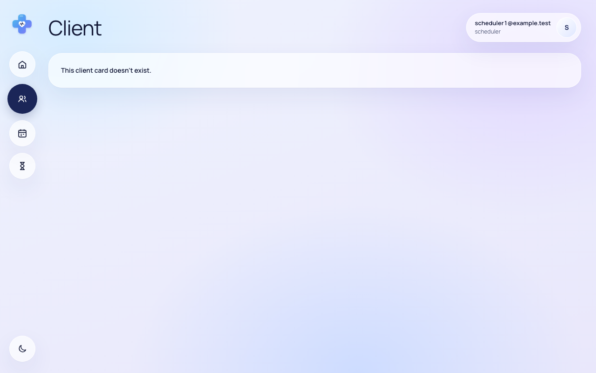

# Звіт UAT — 29.10.2026

- **Застосунок:** https://therapy-scheduling-two.vercel.app (/api/health: коміт `482e07e`)
- **Код тестів:** `task/uat` @ `f62561b`
- **Прогін:** 29.10.2026, 12:04 (Київ), Playwright 24.1 с; AC: 3 — PASS 3, FAIL 0, NEEDS-HUMAN 0
- **Рецензент:** `claude-haiku-5-5`; суперечки → `claude-sonnet-5-5`. Разом за розбір: $0.0074 (ціни API; за підпискою — у межах ліміту плану)
- **Прибирання:** синтетичних uat-*@example.test видалено 0, лишилось 0, їхніх рядків, що лишились: 0
- **Відео й траси:** не в git — `test-results/` локально або артефакт CI; трасу відкриває `npx playwright show-trace <trace.zip>`

| AC | Перевірки | Агент | Підсумок | Чому | Playwright | Розбір |
|---|---|---|---|---|---|---|
| AC-CARD-05 | пройшли | Haiku: PASS | **PASS** | R6: перевірки, агент і цитати збігаються | 5.3 с | $0.0021, 8.0 с |
| AC-CARD-06 | пройшли | Haiku: PASS | **PASS** | R6: перевірки, агент і цитати збігаються | 4.7 с | $0.0025, 7.6 с |
| AC-CARD-16 | пройшли | Haiku: PASS | **PASS** | R6: перевірки, агент і цитати збігаються | 4.2 с | $0.0027, 9.8 с |

## AC-CARD-05 — PASS

**Тест:** AC-CARD-05: therapist1 відкриває картку клієнта therapist2 за прямим посиланням — «You don't have access to this client.», даних немає, картка не змінилась

**Критерій** (requirements/19-planuvalnyk-zapovniuie-kartku-kliienta.md):

> AC-CARD-05: Дано client9 — свій клієнт лише для therapist2. Коли therapist1 відкриває картку client9 за прямим посиланням. Тоді therapist1 бачить повідомлення «You don't have access to this client.», жодних даних client9 не показано, і картка client9 не змінилася.

**Кроки:** ✔ Дано: клієнт — свій лише для therapist2 (є в списку therapist2, немає в списку therapist1) → ✔ Коли: therapist1 відкриває картку цього клієнта за прямим посиланням → ✔ Тоді: therapist1 бачить повідомлення «You don't have access to this client.», жодних даних client9 не показано, і картка client9 не змінилася

**Агент (claude-haiku-5-5, PASS):** На кадрі сторінки /clients/… під заголовком «Client» видно одну картку з текстом «You don't have access to this client.», без жодних даних клієнта. Текст читабельний і збігається з критерієм посимвольно; апостроф виглядає як прямий, але на кадрі це не можна гарантувати на 100%. Інші частини «Тоді» (відсутність даних, незмінність картки) не з кадрів і не оцінювалися.

**Цитати агента, звірені зі сторінкою (aria):**
- «You don't have access to this client.» — є на сторінці

**Правило:** R6: перевірки, агент і цитати збігаються

**Відео:** `test-results/artifacts/client-access-терапевт-AC--cff9b-х-немає-картка-не-змінилась-chromium/video.webm` · **траса:** `test-results/artifacts/client-access-терапевт-AC--cff9b-х-немає-картка-не-змінилась-chromium/trace.zip` (не в git)

**Рішення PM:** ☐ приймаю · ☐ відхилення від вимог (issue «Відхилення від вимог: AC-CARD-05 — …») · @login: ____

## AC-CARD-06 — PASS

**Тест:** AC-CARD-06: therapist1 відкриває форму нової картки за прямим посиланням — форми немає, «Only schedulers and admins can create client cards.», кількість карток та сама

**Критерій** (requirements/19-planuvalnyk-zapovniuie-kartku-kliienta.md):

> AC-CARD-06: Дано therapist1 увійшов у застосунок. Коли він відкриває форму нової картки клієнта за прямим посиланням. Тоді форму не показано, therapist1 одразу бачить повідомлення «Only schedulers and admins can create client cards.», і кількість карток клієнтів не змінилася.

**Кроки:** ✔ Дано: therapist1 увійшов у застосунок → ✔ Коли: він відкриває форму нової картки клієнта за прямим посиланням → ✔ Тоді: форму не показано, therapist1 одразу бачить повідомлення «Only schedulers and admins can create client cards.», і кількість карток клієнтів не змінилася

**Агент (claude-haiku-5-5, PASS):** На кадрі /clients/new видно заголовок «New client» і одне повідомлення «Only schedulers and admins can create client cards.» — текст збігається з критерієм посимвольно. Полів введення й кнопки створення картки на кадрі немає, лише навігація й картка повідомлення. Частина про незмінну кількість карток не з кадрів, тому не оцінювалася.

**Цитати агента, звірені зі сторінкою (aria):**
- «Only schedulers and admins can create client cards.» — є на сторінці
- «New client» — є на сторінці
- «Only schedulers and admins can create client cards.» — є на сторінці

**Правило:** R6: перевірки, агент і цитати збігаються

**Відео:** `test-results/artifacts/client-access-терапевт-AC--d8e4b--»-кількість-карток-та-сама-chromium/video.webm` · **траса:** `test-results/artifacts/client-access-терапевт-AC--d8e4b--»-кількість-карток-та-сама-chromium/trace.zip` (не в git)

**Рішення PM:** ☐ приймаю · ☐ відхилення від вимог (issue «Відхилення від вимог: AC-CARD-06 — …») · @login: ____

## AC-CARD-16 — PASS

**Тест:** AC-CARD-16: scheduler1, а потім therapist1 відкривають посилання на картку, якої немає — «This client card doesn't exist.» і «You don't have access to this client.», даних клієнтів немає

**Критерій** (requirements/19-planuvalnyk-zapovniuie-kartku-kliienta.md):

> AC-CARD-16: Дано картки клієнта, на яку веде посилання, не існує. Коли scheduler1, а потім therapist1 відкриває це посилання. Тоді scheduler1 бачить повідомлення «This client card doesn't exist.», therapist1 — «You don't have access to this client.», і жоден із них не бачить жодних даних клієнтів.

**Кроки:** ✔ Дано: картки клієнта, на яку веде посилання, не існує → ✔ Коли: scheduler1 відкриває це посилання → ✔ Тоді: scheduler1 бачить повідомлення «This client card doesn't exist.» і не бачить жодних даних клієнтів → ✔ Коли: потім therapist1 відкриває це саме посилання → ✔ Тоді: therapist1 бачить повідомлення «You don't have access to this client.» і не бачить жодних даних клієнтів

**Агент (claude-haiku-5-5, PASS):** На frame-then-1.png (scheduler1) видно «This client card doesn't exist.» і немає картки клієнта чи чужих email, крім scheduler1 @example.test у шапці. На frame-then-2.png (therapist1) видно «You don't have access to this client.» і немає даних клієнта, крім therapist1 @example.test у шапці. Апостроф у кадрах прочитано як прямий, як у критерії; при дуже дрібному шрифті це варто підтвердити очима.

**Цитати агента, звірені зі сторінкою (aria):**
- «This client card doesn't exist.» — є на сторінці
- «You don't have access to this client.» — є на сторінці

**Правило:** R6: перевірки, агент і цитати збігаються

**Відео:** `test-results/artifacts/client-access-посилання-на-4de47-ient-»-даних-клієнтів-немає-chromium/video.webm` · **траса:** `test-results/artifacts/client-access-посилання-на-4de47-ient-»-даних-клієнтів-немає-chromium/trace.zip` (не в git)

**Рішення PM:** ☐ приймаю · ☐ відхилення від вимог (issue «Відхилення від вимог: AC-CARD-16 — …») · @login: ____

## Як читати підсумок

- **PASS** — автоматичні перевірки пройшли, агент-рецензент погодився з кадром, а кожну його цитату знайдено на сторінці.
- **FAIL** — впала автоматична перевірка. Агент цього не перекриває: невидимі вади (буфер обміну, база) він на кадрі не побачить.
- **NEEDS-HUMAN** — перевірки зелені, але агент не погодився або його цитати немає на сторінці. Часто це слабкий тест або розбіжність між текстом AC і тестом — питання до PM, а не обов'язково вада продукту.

Правила: R1: перевірка впала — FAIL завжди, агент не перекриває; R2: немає вердикту агента або кадру; R3: перевірки пройшли, агент не погоджується — вирішує людина; R4: цитати агента немає на сторінці (aria) — не підтверджено; R5: помилка сторінки або 5xx під час сценарію; R6: перевірки, агент і цитати збігаються.
