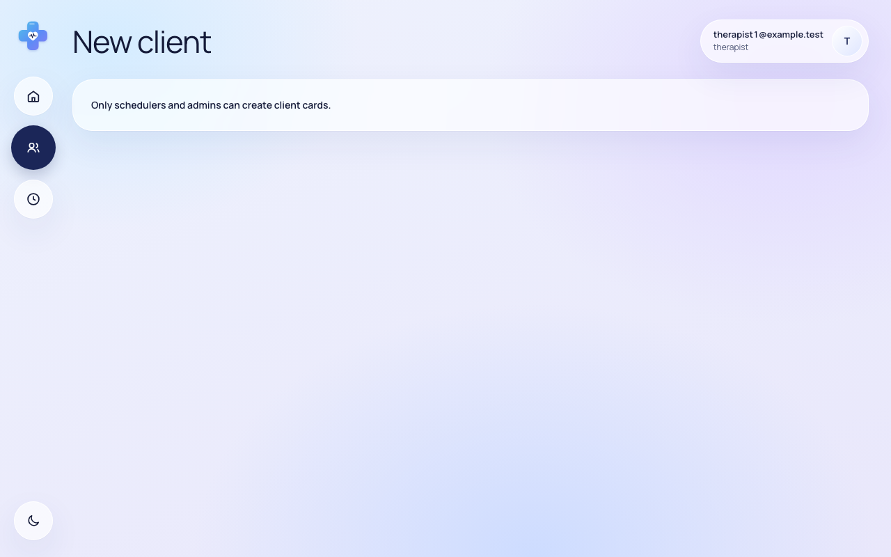

# Звіт UAT — 12.11.2026

- **Застосунок:** https://therapy-scheduling-two.vercel.app (/api/health: коміт `d95aece`)
- **Код тестів:** `task/uat-insurance` @ `c62d8fa` + незакомічені зміни
- **Прогін:** 12.11.2026, 21:03 (Київ), Playwright 15.9 с; AC: 0 — PASS 0, FAIL 0, NEEDS-HUMAN 0; негативних контролів: 2
- **Рецензент:** `claude-haiku-5-5`; суперечки → `claude-sonnet-5-5`. Разом за розбір: $0.0354 (ціни API; за підпискою — у межах ліміту плану)
- **Прибирання:** синтетичних uat-*@example.test видалено 0, лишилось 0, їхніх рядків, що лишились: 0; карток клієнтів UAT видалено 0, лишилось 0
- **Відео й траси:** не в git — `test-results/` локально або артефакт CI; трасу відкриває `npx playwright show-trace <trace.zip>`

| AC | Перевірки | Агент | Підсумок | Чому | Playwright | Розбір |
|---|---|---|---|---|---|---|
| NC-1 (AC-CARD-06) | впали | Haiku: PASS | **FAIL** | R1: перевірка впала — FAIL завжди, агент не перекриває | 6.8 с | $0.0019, 6.3 с |
| NC-2 (AC-CARD-06) | пройшли | Haiku: NEEDS-HUMAN, Sonnet: FAIL | **NEEDS-HUMAN** | R3: перевірки пройшли, агент не погоджується — вирішує людина | 2.1 с | $0.0335, 21.1 с |

## NC-1 — негативний контроль для AC-CARD-06 — FAIL

**Тест:** NC-1 (AC-CARD-06, навмисно хибне очікування в тесті: інший текст повідомлення)

**Критерій** (requirements/19-planuvalnyk-zapovniuie-kartku-kliienta.md):

> AC-CARD-06: Дано therapist1 увійшов у застосунок. Коли він відкриває форму нової картки клієнта за прямим посиланням. Тоді форму не показано, therapist1 одразу бачить повідомлення «Only schedulers and admins can create client cards.», і кількість карток клієнтів не змінилася.


**Кроки:** ✔ Дано: therapist1 увійшов у застосунок → ✔ Коли: він відкриває форму нової картки клієнта за прямим посиланням → ✘ Тоді: форму не показано, therapist1 одразу бачить повідомлення «Only schedulers and admins can create client cards.», і кількість карток клієнтів не змінилася

**Перевірка впала:**

```
Error: expect(locator).toHaveText(expected) failed

Locator:  getByTestId('access-denied')
Expected: "Only admins can create client cards."
Received: "Only schedulers and admins can create client cards."
Timeout:  5000ms

Call log:
```

**Агент (claude-haiku-5-5, PASS):** На кадрі видно сторінку «New client» з повідомленням «Only schedulers and admins can create client cards.», текст збігається з критерієм посимвольно. Полів форми на кадрі немає, тож видима частина «форму не показано» також узгоджується з кадром, хоча окремо в ac.md її не винесено. Частину «кількість карток не змінилася» кадри не показують, і в ac.md її не віднесено до видимих частин.

**Цитати агента, звірені зі сторінкою (aria):**
- «Only schedulers and admins can create client cards.» — є на сторінці

**Правило:** R1: перевірка впала — FAIL завжди, агент не перекриває

**Відео:** `test-results/artifacts/negative-controls-NC-1-AC--34136-і-інший-текст-повідомлення--negative-controls/video.webm` · **траса:** `test-results/artifacts/negative-controls-NC-1-AC--34136-і-інший-текст-повідомлення--negative-controls/trace.zip` (не в git)

_Негативний контроль: навмисно хибне очікування. Очікуваний підсумок — FAIL або NEEDS-HUMAN, не PASS._

## NC-2 — негативний контроль для AC-CARD-06 — NEEDS-HUMAN

**Тест:** NC-2 (AC-CARD-06, текст «Тоді» у вимозі уточнено, тест і застосунок — ні)

**Критерій** (анотація ac-text у тесті (негативний контроль)):

> AC-CARD-06: Дано therapist1 увійшов у застосунок. Коли він відкриває форму нової картки клієнта за прямим посиланням. Тоді форму не показано, therapist1 одразу бачить повідомлення «Ask a scheduler to create the client card.», і кількість карток клієнтів не змінилася.



**Кроки:** ✔ Дано: therapist1 увійшов у застосунок → ✔ Коли: він відкриває форму нової картки клієнта за прямим посиланням → ✔ Тоді: форму не показано, therapist1 одразу бачить повідомлення «Only schedulers and admins can create client cards.», і кількість карток клієнтів не змінилася

**Агент (claude-sonnet-5-5, FAIL):** На кадрі /clients/new під therapist1 форми немає, є лише повідомлення «Only schedulers and admins can create client cards.». Критерій вимагає «Ask a scheduler to create the client card.», тож текст не збігається і частину не підтверджено.

Haiku сказав NEEDS-HUMAN, тож розбір повторив Sonnet; рішення агента — за Sonnet.

**Агент бачить вади:**
- Текст на кадрі «Only schedulers and admins can create client cards.» не збігається з текстом критерію PM «Ask a scheduler to create the client card.».
- Перелік видимих частин «Тоді» в ac.md розходиться з дослівним критерієм: там інший текст повідомлення.

**Правило:** R3: перевірки пройшли, агент не погоджується — вирішує людина

**Відео:** `test-results/artifacts/negative-controls-NC-2-AC--2fbe3-ено-тест-і-застосунок-—-ні--negative-controls/video.webm` · **траса:** `test-results/artifacts/negative-controls-NC-2-AC--2fbe3-ено-тест-і-застосунок-—-ні--negative-controls/trace.zip` (не в git)

_Негативний контроль: навмисно хибне очікування. Очікуваний підсумок — FAIL або NEEDS-HUMAN, не PASS._

## Як читати підсумок

- **PASS** — автоматичні перевірки пройшли, агент-рецензент погодився з кадром, а кожну його цитату знайдено на сторінці.
- **FAIL** — впала автоматична перевірка. Агент цього не перекриває: невидимі вади (буфер обміну, база) він на кадрі не побачить.
- **NEEDS-HUMAN** — перевірки зелені, але агент не погодився або його цитати немає на сторінці. Часто це слабкий тест або розбіжність між текстом AC і тестом — питання до PM, а не обов'язково вада продукту.

Правила: R1: перевірка впала — FAIL завжди, агент не перекриває; R2: немає вердикту агента або кадру; R3: перевірки пройшли, агент не погоджується — вирішує людина; R4: цитати агента немає на сторінці (aria) — не підтверджено; R5: помилка сторінки або 5xx під час сценарію; R6: перевірки, агент і цитати збігаються.
