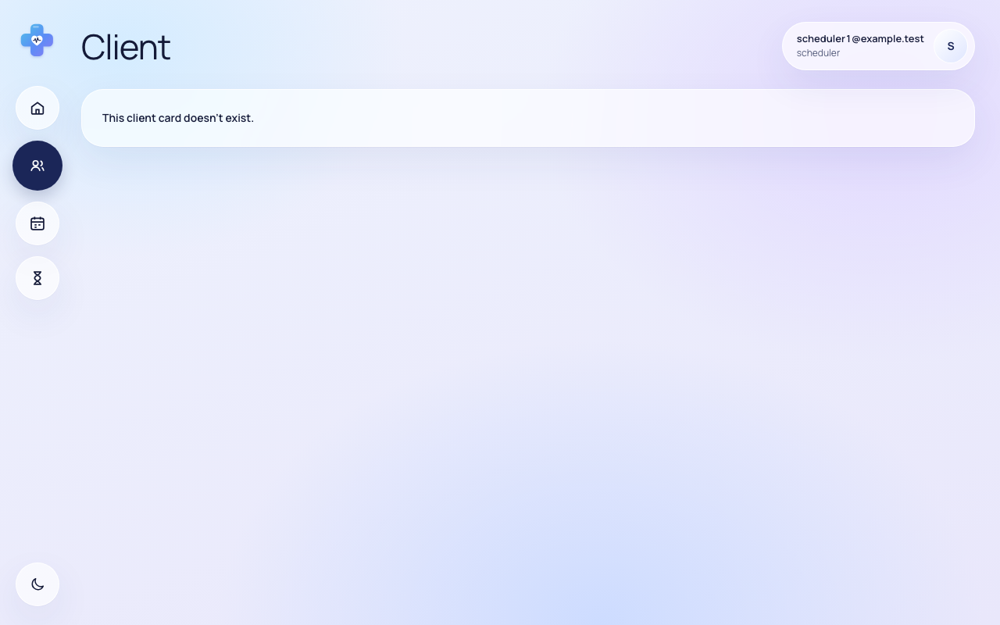
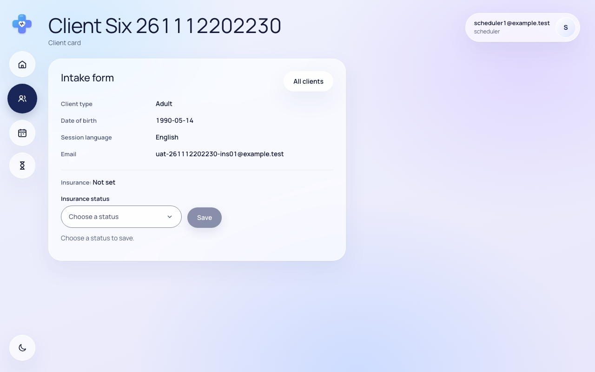
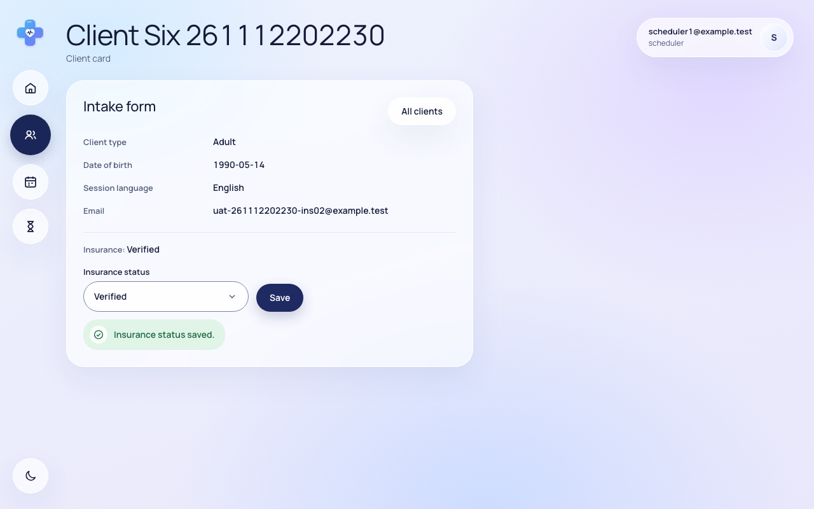
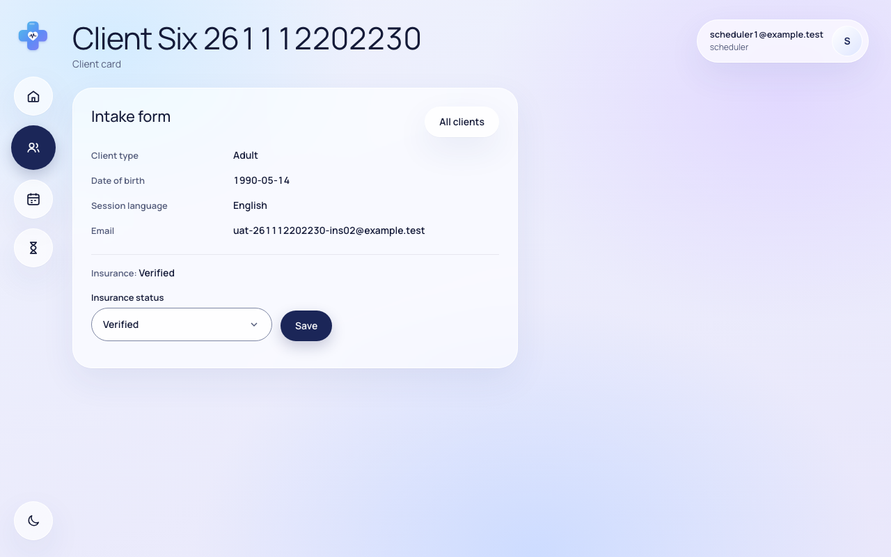
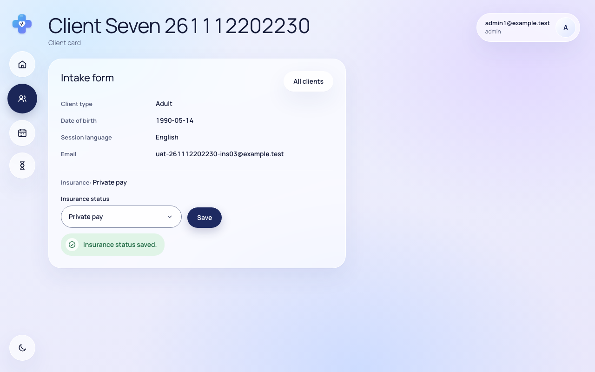
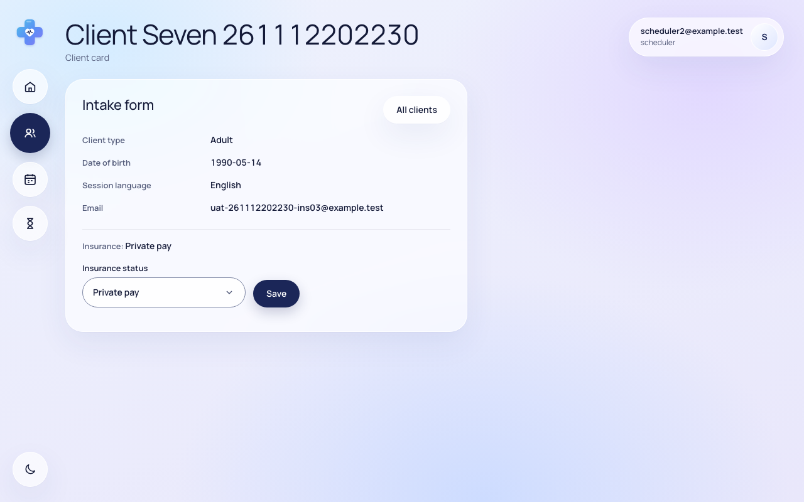
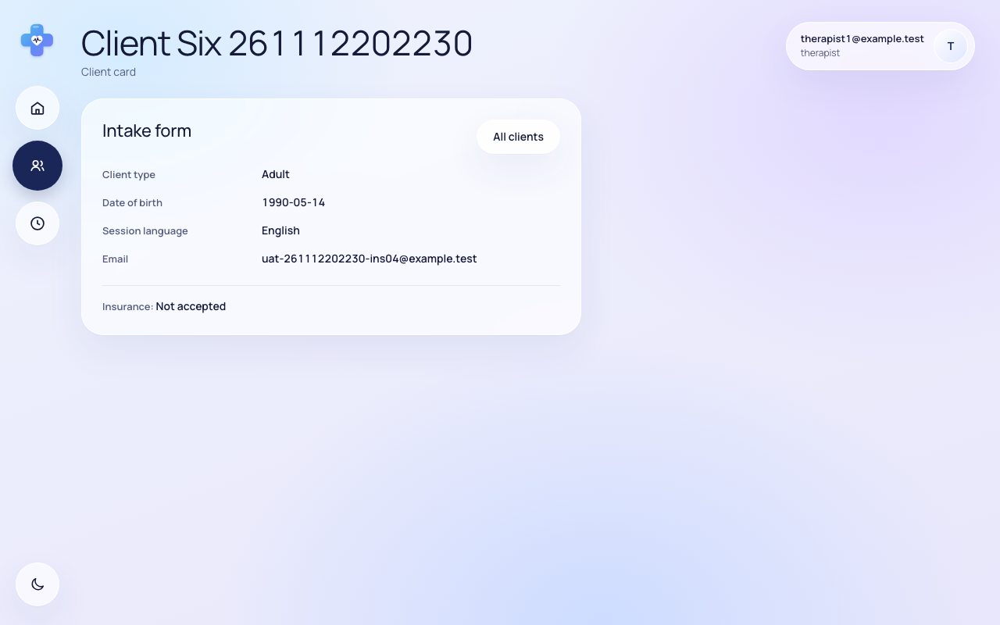
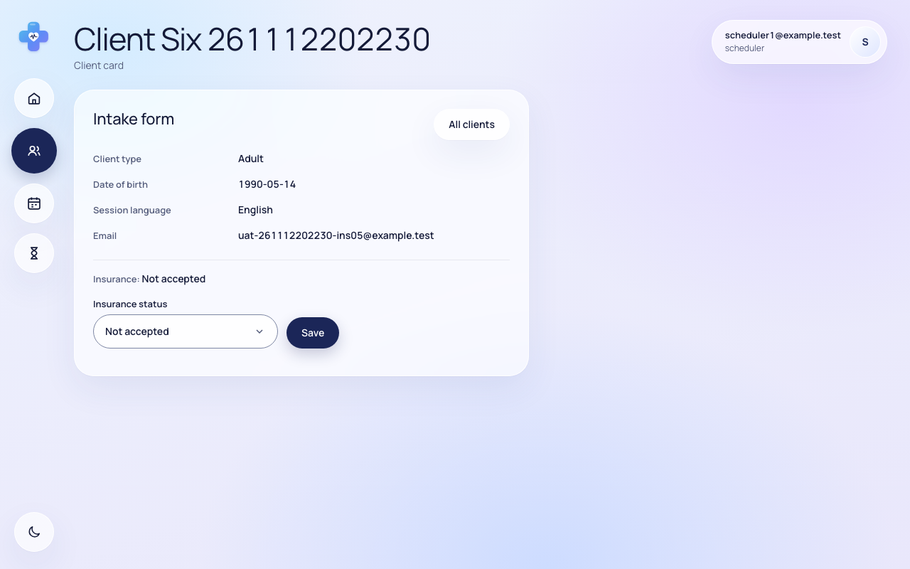
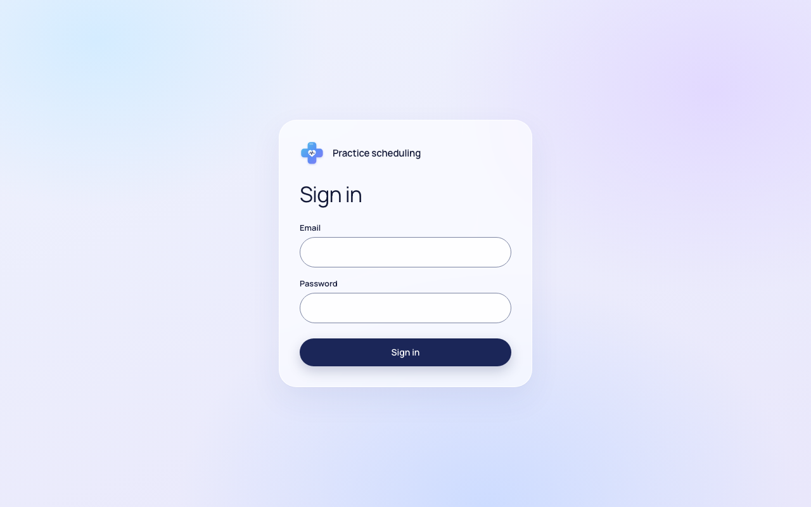

# Звіт UAT — 12.11.2026

- **Застосунок:** https://therapy-scheduling-two.vercel.app (/api/health: коміт `d95aece`)
- **Код тестів:** `task/uat-insurance` @ `2d14dd8`
- **Прогін:** 12.11.2026, 22:22 (Київ), Playwright 66.9 с; AC: 9 — PASS 9, FAIL 0, NEEDS-HUMAN 0
- **Рецензент:** `claude-haiku-5-5`; суперечки → `claude-sonnet-5-5`. Разом за розбір: $0.0707 (ціни API; за підпискою — у межах ліміту плану)
- **Прибирання:** синтетичних uat-*@example.test видалено 0, лишилось 0, їхніх рядків, що лишились: 0; карток клієнтів UAT видалено 6, лишилось 0
- **Відео й траси:** не в git — `test-results/` локально або артефакт CI; трасу відкриває `npx playwright show-trace <trace.zip>`

| AC | Перевірки | Агент | Підсумок | Чому | Playwright | Розбір |
|---|---|---|---|---|---|---|
| AC-CARD-05 | пройшли | Haiku: PASS | **PASS** | R6: перевірки, агент і цитати збігаються | 6.6 с | $0.0022, 8.5 с |
| AC-CARD-06 | пройшли | Haiku: PASS | **PASS** | R6: перевірки, агент і цитати збігаються | 5.4 с | $0.0021, 8.2 с |
| AC-CARD-16 | пройшли | Haiku: NEEDS-HUMAN, Sonnet: PASS | **PASS** | R6: перевірки, агент і цитати збігаються | 4.8 с | $0.0519, 21.5 с |
| AC-INS-01 | пройшли | Haiku: PASS | **PASS** | R6: перевірки, агент і цитати збігаються | 2.7 с | $0.0019, 5.8 с |
| AC-INS-02 | пройшли | Haiku: PASS | **PASS** | R6: перевірки, агент і цитати збігаються | 10.5 с | $0.0027, 7.6 с |
| AC-INS-03 | пройшли | Haiku: PASS | **PASS** | R6: перевірки, агент і цитати збігаються | 7.6 с | $0.0028, 8.6 с |
| AC-INS-04 | пройшли | Haiku: PASS | **PASS** | R6: перевірки, агент і цитати збігаються | 3.9 с | $0.0024, 8.7 с |
| AC-INS-05 | пройшли | Haiku: PASS | **PASS** | R6: перевірки, агент і цитати збігаються | 5.2 с | $0.0020, 7.0 с |
| AC-INS-06 | пройшли | Haiku: PASS | **PASS** | R6: перевірки, агент і цитати збігаються | 5.1 с | $0.0028, 8.4 с |

## AC-CARD-05 — PASS

**Тест:** AC-CARD-05: therapist1 відкриває картку клієнта therapist2 за прямим посиланням — «You don't have access to this client.», даних немає, картка не змінилась

**Критерій** (requirements/19-planuvalnyk-zapovniuie-kartku-kliienta.md):

> AC-CARD-05: Дано client9 — свій клієнт лише для therapist2. Коли therapist1 відкриває картку client9 за прямим посиланням. Тоді therapist1 бачить повідомлення «You don't have access to this client.», жодних даних client9 не показано, і картка client9 не змінилася.

**Кроки:** ✔ Дано: клієнт — свій лише для therapist2 (є в списку therapist2, немає в списку therapist1) → ✔ Коли: therapist1 відкриває картку цього клієнта за прямим посиланням → ✔ Тоді: therapist1 бачить повідомлення «You don't have access to this client.», жодних даних client9 не показано, і картка client9 не змінилася

**Агент (claude-haiku-5-5, PASS):** На кадрі видно сторінку «Client» з однією карткою, у якій написано «You don't have access to this client.» Текст збігається з критерієм посимвольно; апостроф виглядає прямим, хоча на цій роздільності відрізнити його від типографського важко. Дані клієнта на кадрі не видно, а це «Не з кадрів» частина, яку я не оцінюю. У верхньому правому куті показано therapist1@example.test, тобто сесія саме therapist1.

**Цитати агента, звірені зі сторінкою (aria):**
- «You don't have access to this client.» — є на сторінці

**Правило:** R6: перевірки, агент і цитати збігаються

**Відео:** `test-results/artifacts/client-access-терапевт-AC--cff9b-х-немає-картка-не-змінилась-chromium/video.webm` · **траса:** `test-results/artifacts/client-access-терапевт-AC--cff9b-х-немає-картка-не-змінилась-chromium/trace.zip` (не в git)

**Рішення PM:** ☐ приймаю · ☐ відхилення від вимог (issue «Відхилення від вимог: AC-CARD-05 — …») · @login: ____

## AC-CARD-06 — PASS

**Тест:** AC-CARD-06: therapist1 відкриває форму нової картки за прямим посиланням — форми немає, «Only schedulers and admins can create client cards.», кількість карток та сама

**Критерій** (requirements/19-planuvalnyk-zapovniuie-kartku-kliienta.md):

> AC-CARD-06: Дано therapist1 увійшов у застосунок. Коли він відкриває форму нової картки клієнта за прямим посиланням. Тоді форму не показано, therapist1 одразу бачить повідомлення «Only schedulers and admins can create client cards.», і кількість карток клієнтів не змінилася.

**Кроки:** ✔ Дано: therapist1 увійшов у застосунок → ✔ Коли: він відкриває форму нової картки клієнта за прямим посиланням → ✔ Тоді: форму не показано, therapist1 одразу бачить повідомлення «Only schedulers and admins can create client cards.», і кількість карток клієнтів не змінилася

**Агент (claude-haiku-5-5, PASS):** На кадрі видно сторінку «New client» з єдиним блоком, у якому текст повідомлення збігається з критерієм посимвольно. Полів введення й кнопки створення на кадрі немає, тож форму не показано. Частину про кількість карток не оцінював, бо вона з розділу «Не з кадрів».

**Цитати агента, звірені зі сторінкою (aria):**
- «Only schedulers and admins can create client cards.» — є на сторінці
- «New client» — є на сторінці

**Правило:** R6: перевірки, агент і цитати збігаються

**Відео:** `test-results/artifacts/client-access-терапевт-AC--d8e4b--»-кількість-карток-та-сама-chromium/video.webm` · **траса:** `test-results/artifacts/client-access-терапевт-AC--d8e4b--»-кількість-карток-та-сама-chromium/trace.zip` (не в git)

**Рішення PM:** ☐ приймаю · ☐ відхилення від вимог (issue «Відхилення від вимог: AC-CARD-06 — …») · @login: ____

## AC-CARD-16 — PASS

**Тест:** AC-CARD-16: scheduler1, а потім therapist1 відкривають посилання на картку, якої немає — «This client card doesn't exist.» і «You don't have access to this client.», даних клієнтів немає

**Критерій** (requirements/19-planuvalnyk-zapovniuie-kartku-kliienta.md):

> AC-CARD-16: Дано картки клієнта, на яку веде посилання, не існує. Коли scheduler1, а потім therapist1 відкриває це посилання. Тоді scheduler1 бачить повідомлення «This client card doesn't exist.», therapist1 — «You don't have access to this client.», і жоден із них не бачить жодних даних клієнтів.

**Кроки:** ✔ Дано: картки клієнта, на яку веде посилання, не існує → ✔ Коли: scheduler1 відкриває це посилання → ✔ Тоді: scheduler1 бачить повідомлення «This client card doesn't exist.» і не бачить жодних даних клієнтів → ✔ Коли: потім therapist1 відкриває це саме посилання → ✔ Тоді: therapist1 бачить повідомлення «You don't have access to this client.» і не бачить жодних даних клієнтів

**Агент (claude-sonnet-5-5, PASS):** На першому кадрі користувач scheduler1@example.test бачить «This client card doesn't exist.», на другому therapist1@example.test бачить «You don't have access to this client.». Інших даних клієнтів на кадрах не видно, але цю частину не оцінював. Тип апострофа (прямий чи типографський) на кадрі розрізнити важко.

Haiku сказав NEEDS-HUMAN, тож розбір повторив Sonnet; рішення агента — за Sonnet.

**Цитати агента, звірені зі сторінкою (aria):**
- «This client card doesn't exist.» — є на сторінці
- «You don't have access to this client.» — є на сторінці

**Правило:** R6: перевірки, агент і цитати збігаються

**Відео:** `test-results/artifacts/client-access-посилання-на-4de47-ient-»-даних-клієнтів-немає-chromium/video.webm` · **траса:** `test-results/artifacts/client-access-посилання-на-4de47-ient-»-даних-клієнтів-немає-chromium/trace.zip` (не в git)

**Рішення PM:** ☐ приймаю · ☐ відхилення від вимог (issue «Відхилення від вимог: AC-CARD-16 — …») · @login: ____

## AC-INS-01 — PASS

**Тест:** AC-INS-01: scheduler1 відкриває картку client6, статус якої ще ніхто не позначав — «Insurance: Not set»

**Критерій** (requirements/33-planuvalnyk-status-strakhuvannia.md):

> AC-INS-01: Дано картку client6 створено, і статус перевірки страхування ще ніхто не позначав. Коли scheduler1 відкриває картку client6. Тоді в картці показано «Insurance: Not set».

**Кроки:** ✔ Дано: картку client6 створено, і статус перевірки страхування ще ніхто не позначав → ✔ Коли: scheduler1 відкриває картку client6 → ✔ Тоді: в картці показано «Insurance: Not set»

**Агент (claude-haiku-5-5, PASS):** На кадрі видно картку «Client Six 261112202230» з рядком «Insurance: Not set» над полем «Insurance status» із значенням «Choose a status». Текст збігається з критерієм посимвольно, кадр повний і читабельний.

**Цитати агента, звірені зі сторінкою (aria):**
- «Insurance: Not set» — є на сторінці

**Правило:** R6: перевірки, агент і цитати збігаються

**Відео:** `test-results/artifacts/client-insurance-плануваль-00e66-начав-—-«Insurance-Not-set»-chromium/video.webm` · **траса:** `test-results/artifacts/client-insurance-плануваль-00e66-начав-—-«Insurance-Not-set»-chromium/trace.zip` (не в git)

**Рішення PM:** ☐ приймаю · ☐ відхилення від вимог (issue «Відхилення від вимог: AC-INS-01 — …») · @login: ____

## AC-INS-02 — PASS

**Тест:** AC-INS-02: scheduler1 позначає статус «Verified» у картці client6 — «Insurance status saved.» і «Insurance: Verified», зокрема після повторного відкриття

**Критерій** (requirements/33-planuvalnyk-status-strakhuvannia.md):

> AC-INS-02: Дано картка client6 показує «Insurance: Not set». Коли scheduler1 позначає статус перевірки страхування «Verified». Тоді scheduler1 бачить повідомлення «Insurance status saved.», а картка client6 показує «Insurance: Verified» і після того, як scheduler1 відкриє її знову.

**Кроки:** ✔ Дано: картка client6 показує «Insurance: Not set» → ✔ Коли: scheduler1 позначає статус перевірки страхування «Verified» → ✔ Тоді: scheduler1 бачить повідомлення «Insurance status saved.», а картка client6 показує «Insurance: Verified» → ✔ Коли: scheduler1 відкриває картку client6 знову → ✔ Тоді: картка client6 показує «Insurance: Verified» і після того, як scheduler1 відкриє її знову

**Агент (claude-haiku-5-5, PASS):** На frame-then-1.png видно зелене повідомлення «Insurance status saved.» і рядок «Insurance: Verified» у картці клієнта Client Six. На frame-then-2.png після повторного відкриття картки той самий рядок «Insurance: Verified» присутній, поле статусу показує Verified. Кадри чіткі, без завантаження та обрізання.

**Цитати агента, звірені зі сторінкою (aria):**
- «Insurance status saved.» — є на сторінці
- «Insurance: Verified» — є на сторінці
- «Insurance: Verified» — є на сторінці

**Правило:** R6: перевірки, агент і цитати збігаються

**Відео:** `test-results/artifacts/client-insurance-плануваль-37625--після-повторного-відкриття-chromium/video.webm` · **траса:** `test-results/artifacts/client-insurance-плануваль-37625--після-повторного-відкриття-chromium/trace.zip` (не в git)

**Рішення PM:** ☐ приймаю · ☐ відхилення від вимог (issue «Відхилення від вимог: AC-INS-02 — …») · @login: ____

## AC-INS-03 — PASS

**Тест:** AC-INS-03: admin1 змінює статус client7 з «Verified» на «Private pay», потім scheduler2 відкриває картку — обидва бачать «Insurance: Private pay»

**Критерій** (requirements/33-planuvalnyk-status-strakhuvannia.md):

> AC-INS-03: Дано картка client7 показує «Insurance: Verified». Коли admin1 змінює статус перевірки страхування на «Private pay», а потім scheduler2 відкриває картку client7. Тоді і admin1, і scheduler2 бачать у картці «Insurance: Private pay».

**Кроки:** ✔ Дано: картка client7 показує «Insurance: Verified» → ✔ Коли: admin1 змінює статус перевірки страхування на «Private pay» → ✔ Тоді: admin1 бачить у картці «Insurance: Private pay» → ✔ Коли: потім scheduler2 відкриває картку client7 → ✔ Тоді: scheduler2 бачить у картці «Insurance: Private pay»

**Агент (claude-haiku-5-5, PASS):** На frame-then-1.png у шапці сесія admin1@example.test, у картці видно «Insurance: Private pay», поруч напис «Insurance status saved.». На frame-then-2.png у шапці scheduler2@example.test, у картці та сама строка «Insurance: Private pay» для того самого клієнта (Client Seven 261112202230, email uat-261112202230-ins03@example.test). Обидві видимі частини «Тоді» підтверджені; статус у базі не оцінювався.

**Цитати агента, звірені зі сторінкою (aria):**
- «Insurance: Private pay» — є на сторінці
- «Insurance: Private pay» — є на сторінці

**Правило:** R6: перевірки, агент і цитати збігаються

**Відео:** video-admin1 `test-results/artifacts/client-insurance-плануваль-9c717-ать-«Insurance-Private-pay»-chromium/attachments/video-admin1-8ba352265afd1f4942539c453548a34e9fa3057c.webm`, video-scheduler2 `test-results/artifacts/client-insurance-плануваль-9c717-ать-«Insurance-Private-pay»-chromium/attachments/video-scheduler2-20e160f0c41068f804eb8bea4d4153c7e6d3b24f.webm`, video `test-results/artifacts/client-insurance-плануваль-9c717-ать-«Insurance-Private-pay»-chromium/video.webm` · **траса:** `test-results/artifacts/client-insurance-плануваль-9c717-ать-«Insurance-Private-pay»-chromium/trace.zip` (не в git)

**Рішення PM:** ☐ приймаю · ☐ відхилення від вимог (issue «Відхилення від вимог: AC-INS-03 — …») · @login: ____

## AC-INS-04 — PASS

**Тест:** AC-INS-04: therapist1 відкриває картку свого клієнта client6 — «Insurance: Not accepted», змінити статус не запропоновано

**Критерій** (requirements/33-planuvalnyk-status-strakhuvannia.md):

> AC-INS-04: Дано client6 — свій клієнт therapist1, і картка client6 показує «Insurance: Not accepted». Коли therapist1 відкриває картку client6. Тоді він бачить «Insurance: Not accepted», а змінити статус перевірки страхування в картці йому не запропоновано.

**Кроки:** ✔ Дано: client6 — свій клієнт therapist1, і картка client6 показує «Insurance: Not accepted» → ✔ Коли: therapist1 відкриває картку client6 → ✔ Тоді: він бачить «Insurance: Not accepted», а змінити статус перевірки страхування в картці йому не запропоновано

**Агент (claude-haiku-5-5, PASS):** На кадрі сторінка /clients/f40951d1-1407-4a0b-9feb-0a0a0c291a8b з карткою «Intake form» і рядком «Insurance: Not accepted» без будь-якого поля статусу страхування та без кнопки «Save». Частина про відсутність поля і кнопки перевірена за видимим вмістом картки: єдиний рядок страхування — інформаційний, інших елементів керування немає. Кадр повний, не обрізаний і читабельний.

**Цитати агента, звірені зі сторінкою (aria):**
- «Insurance: Not accepted» — є на сторінці
- «Client type» — є на сторінці
- «Date of birth» — є на сторінці
- «Session language» — є на сторінці
- «Email» — є на сторінці
- «Insurance: Not accepted» — є на сторінці

**Правило:** R6: перевірки, агент і цитати збігаються

**Відео:** `test-results/artifacts/client-insurance-терапевт--7aa85-ити-статус-не-запропоновано-chromium/video.webm` · **траса:** `test-results/artifacts/client-insurance-терапевт--7aa85-ити-статус-не-запропоновано-chromium/trace.zip` (не в git)

**Рішення PM:** ☐ приймаю · ☐ відхилення від вимог (issue «Відхилення від вимог: AC-INS-04 — …») · @login: ____

## AC-INS-05 — PASS

**Тест:** AC-INS-05: therapist1 напряму, оминаючи сторінки, пробує змінити статус client6 на «Verified» — статус не змінився, scheduler1 бачить «Insurance: Not accepted»

**Критерій** (requirements/33-planuvalnyk-status-strakhuvannia.md):

> AC-INS-05: Дано client6 — свій клієнт therapist1, і картка client6 показує «Insurance: Not accepted». Коли therapist1 напряму, оминаючи сторінки застосунку, пробує змінити статус перевірки страхування client6 на «Verified». Тоді статус не змінився: scheduler1 у картці client6 бачить «Insurance: Not accepted».

**Кроки:** ✔ Дано: client6 — свій клієнт therapist1, і картка client6 показує «Insurance: Not accepted» → ✔ Коли: therapist1 напряму, оминаючи сторінки застосунку, пробує змінити статус client6 на «Verified» → ✔ Коли: scheduler1 відкриває картку client6 → ✔ Тоді: статус не змінився: scheduler1 у картці client6 бачить «Insurance: Not accepted»

**Агент (claude-haiku-5-5, PASS):** На кадрі сторінка картки «Client Six 261112202230» відкрита під сесією scheduler1@example.test (праворуч угорі). Рядок «Insurance: Not accepted» видно в картці, а вибране значення в полі «Insurance status» — теж «Not accepted». Кадр чіткий, не обрізаний, завантаження немає. Частини «Не з кадрів» (RLS, стан у базі) не оцінював.

**Цитати агента, звірені зі сторінкою (aria):**
- «Insurance: Not accepted» — є на сторінці

**Правило:** R6: перевірки, агент і цитати збігаються

**Відео:** video-scheduler1 `test-results/artifacts/client-insurance-терапевт--a1b1e-ть-«Insurance-Not-accepted»-chromium/attachments/video-scheduler1-0d226b5e75fc80f19cf7feff661baa30962f6f24.webm`, video `test-results/artifacts/client-insurance-терапевт--a1b1e-ть-«Insurance-Not-accepted»-chromium/video.webm` · **траса:** `test-results/artifacts/client-insurance-терапевт--a1b1e-ть-«Insurance-Not-accepted»-chromium/trace.zip` (не в git)

**Рішення PM:** ☐ приймаю · ☐ відхилення від вимог (issue «Відхилення від вимог: AC-INS-05 — …») · @login: ____

## AC-INS-06 — PASS

**Тест:** AC-INS-06: користувач без входу відкриває картку client6 за прямим посиланням — лише сторінка входу, а scheduler1 далі бачить «Insurance: Verified»

**Критерій** (requirements/33-planuvalnyk-status-strakhuvannia.md):

> AC-INS-06: Дано користувач не увійшов у застосунок, а картка client6 показує «Insurance: Verified». Коли він відкриває картку client6 за прямим посиланням. Тоді він бачить лише сторінку входу, статусу страхування й інших даних client6 не показано, а scheduler1 після цього бачить у картці client6 «Insurance: Verified».

**Кроки:** ✔ Дано: користувач не увійшов у застосунок, а картка client6 показує «Insurance: Verified» → ✔ Коли: він відкриває картку client6 за прямим посиланням → ✔ Тоді: він бачить лише сторінку входу, статусу страхування й інших даних client6 не показано → ✔ Коли: scheduler1 після цього відкриває картку client6 → ✔ Тоді: scheduler1 після цього бачить у картці client6 «Insurance: Verified»

**Агент (claude-haiku-5-5, PASS):** На кадрі frame-then-1.png видно сторінку входу «Practice scheduling» з полями Email і Password та кнопкою Sign in, без даних клієнта. На кадрі frame-then-2.png у картці клієнта, яку відкрито в сесії scheduler1 (зліва вгорі «scheduler1@example.test»), видно рядок «Insurance: Verified». Частина про відсутність даних для неавторизованого користувача і стан бази не оцінювалась, бо це не з кадрів.

**Цитати агента, звірені зі сторінкою (aria):**
- «Email» — є на сторінці
- «Password» — є на сторінці
- «Sign in» — є на сторінці
- «Insurance: Verified» — є на сторінці

**Правило:** R6: перевірки, агент і цитати збігаються

**Відео:** video-scheduler1 `test-results/artifacts/client-insurance-без-входу-b84c5-бачить-«Insurance-Verified»-chromium/attachments/video-scheduler1-8bda3ca3f814e65b720d6b333d492524a6a331ac.webm`, video `test-results/artifacts/client-insurance-без-входу-b84c5-бачить-«Insurance-Verified»-chromium/video.webm` · **траса:** `test-results/artifacts/client-insurance-без-входу-b84c5-бачить-«Insurance-Verified»-chromium/trace.zip` (не в git)

**Рішення PM:** ☐ приймаю · ☐ відхилення від вимог (issue «Відхилення від вимог: AC-INS-06 — …») · @login: ____

## Як читати підсумок

- **PASS** — автоматичні перевірки пройшли, агент-рецензент погодився з кадром, а кожну його цитату знайдено на сторінці.
- **FAIL** — впала автоматична перевірка. Агент цього не перекриває: невидимі вади (буфер обміну, база) він на кадрі не побачить.
- **NEEDS-HUMAN** — перевірки зелені, але агент не погодився або його цитати немає на сторінці. Часто це слабкий тест або розбіжність між текстом AC і тестом — питання до PM, а не обов'язково вада продукту.

Правила: R1: перевірка впала — FAIL завжди, агент не перекриває; R2: немає вердикту агента або кадру; R3: перевірки пройшли, агент не погоджується — вирішує людина; R4: цитати агента немає на сторінці (aria) — не підтверджено; R5: помилка сторінки або 5xx під час сценарію; R6: перевірки, агент і цитати збігаються.
