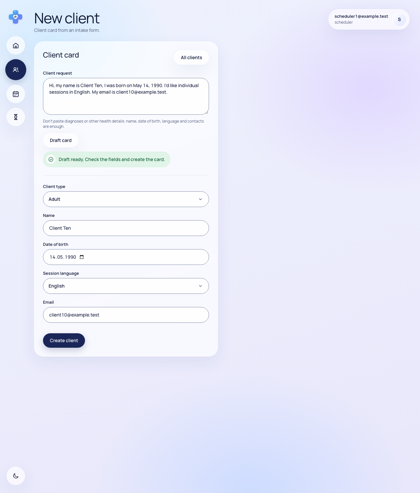
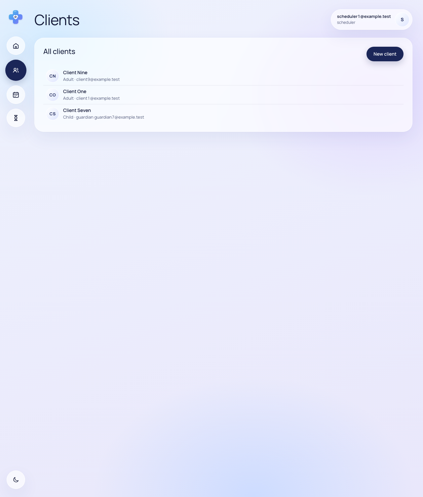
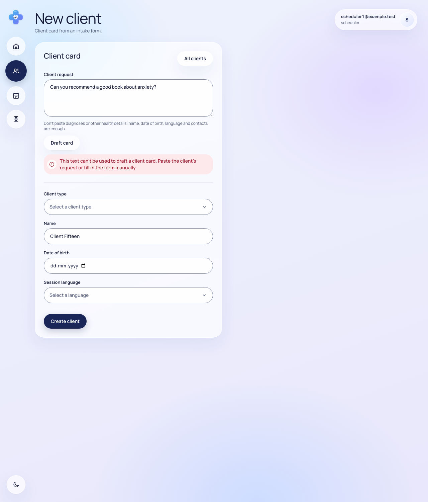
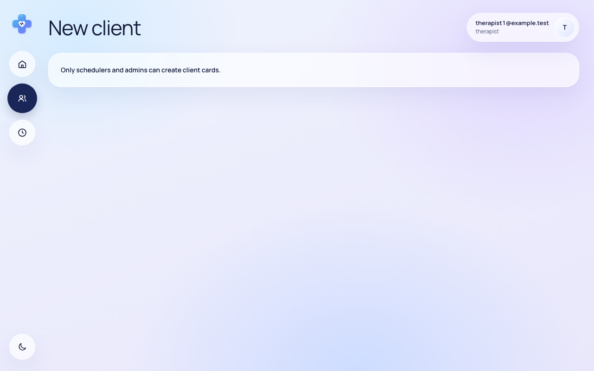

# Звіт UAT — 16.11.2026

- **Застосунок:** https://therapy-scheduling-two.vercel.app (/api/health: коміт `b55a165`)
- **Код тестів:** `task/uat-intake` @ `237eb0b` + незакомічені зміни
- **Прогін:** 16.11.2026, 18:15 (Київ), Playwright 35.6 с; AC: 4 — PASS 3, FAIL 0, NEEDS-HUMAN 1
- **Рецензент:** `claude-haiku-5-5`; суперечки → `claude-sonnet-5-5`. Разом за розбір: $0.0616 (ціни API; за підпискою — у межах ліміту плану)
- **Прибирання:** синтетичних uat-*@example.test видалено 0, лишилось 0, їхніх рядків, що лишились: 0; карток клієнтів UAT видалено 0, лишилось 0
- **Відео й траси:** не в git — `test-results/` локально або артефакт CI; трасу відкриває `npx playwright show-trace <trace.zip>`

| AC | Перевірки | Агент | Підсумок | Чому | Playwright | Розбір |
|---|---|---|---|---|---|---|
| AC-INTAKE-01 | пройшли | Haiku: NEEDS-HUMAN, Sonnet: NEEDS-HUMAN | **NEEDS-HUMAN** | R3: перевірки пройшли, агент не погоджується — вирішує людина | 9.3 с | $0.0546, 21.6 с |
| AC-INTAKE-03 | пройшли | Haiku: PASS | **PASS** | R6: перевірки, агент і цитати збігаються | 7.0 с | $0.0022, 8.3 с |
| AC-INTAKE-06 | пройшли | Haiku: PASS | **PASS** | R6: перевірки, агент і цитати збігаються | 7.7 с | $0.0030, 9.7 с |
| AC-INTAKE-09 | пройшли | Haiku: PASS | **PASS** | R6: перевірки, агент і цитати збігаються | 2.8 с | $0.0018, 6.6 с |

## AC-INTAKE-01 — NEEDS-HUMAN

**Тест:** AC-INTAKE-01: scheduler1 просить скласти чернетку з тексту звернення Client Ten — форма заповнена, «Draft ready. Check the fields and create the card.»

**Критерій** (requirements/36-planuvalnyk-chernetka-kartky-z-tekstu.md):

> AC-INTAKE-01: Дано сьогодні 2026-11-13, і клієнта з email client10@example.test ще немає. Коли scheduler1 у формі нової картки просить скласти чернетку з тексту звернення «Hi, my name is Client Ten, I was born on May 14, 1990. I'd like individual sessions in English. My email is client10@example.test.». Тоді у формі вибрано Client type «Adult», Name — «Client Ten», Date of birth — 1990-05-14, Session language — «English», Email — client10@example.test, і scheduler1 бачить повідомлення «Draft ready. Check the fields and create the card.»

**Кроки:** ✔ Дано: сьогодні 2026-11-13, і клієнта з email client10@example.test ще немає → ✔ Коли: scheduler1 у формі нової картки просить скласти чернетку з тексту звернення → ✔ Тоді: у формі вибрано Client type «Adult», Name — «Client Ten», Date of birth — 1990-05-14, Session language — «English», Email — client10@example.test → ✔ Тоді: scheduler1 бачить повідомлення «Draft ready. Check the fields and create the card.»

**Агент (claude-sonnet-5-5, NEEDS-HUMAN):** На обох кадрах форма /clients/new: Client type «Adult», Name «Client Ten», Session language «English», Email «client10@example.test», а під кнопкою Draft card є повідомлення «Draft ready. Check the fields and create the card.». Дата народження відображена як 14.05.1990, що за змістом збігається з 1990-05-14, але посимвольно відрізняється, тому потрібна людина, щоб підтвердити значення поля.

Haiku сказав NEEDS-HUMAN, тож розбір повторив Sonnet; рішення агента — за Sonnet.

**Агент бачить вади:**
- Поле Date of birth на кадрі показує «14.05.1990» (локальний формат date-input), а не «1990-05-14» як у критерії. Збіг із 1990-05-14 за кадром підтвердити не можна, лише за значенням поля.

**Цитати агента, звірені зі сторінкою (aria):**
- «Draft ready. Check the fields and create the card.» — є на сторінці

**Правило:** R3: перевірки пройшли, агент не погоджується — вирішує людина

**Відео:** `test-results/artifacts/client-intake-планувальник-a69d5-ields-and-create-the-card-»-chromium/video.webm` · **траса:** `test-results/artifacts/client-intake-планувальник-a69d5-ields-and-create-the-card-»-chromium/trace.zip` (не в git)

**Рішення PM:** ☐ приймаю · ☐ відхилення від вимог (issue «Відхилення від вимог: AC-INTAKE-01 — …») · @login: ____

## AC-INTAKE-03 — PASS

**Тест:** AC-INTAKE-03: чернетку з тексту AC-INTAKE-01 заповнено, scheduler1 не створює картку — «Client Ten» у списку клієнтів немає

**Критерій** (requirements/36-planuvalnyk-chernetka-kartky-z-tekstu.md):

> AC-INTAKE-03: Дано чернетку за текстом з AC-INTAKE-01 заповнено у формі нової картки. Коли scheduler1 не створює картку й відкриває список клієнтів. Тоді картки «Client Ten» у списку немає: картку створює лише сам планувальник, коли зберігає форму.

**Кроки:** ✔ Дано: чернетку за текстом з AC-INTAKE-01 заповнено у формі нової картки → ✔ Коли: scheduler1 не створює картку й відкриває список клієнтів → ✔ Тоді: картки «Client Ten» у списку немає: картку створює лише сам планувальник, коли зберігає форму

**Агент (claude-haiku-5-5, PASS):** На кадрі сторінка «Clients» з заголовком «All clients» і трьома рядками: Client Nine, Client One, Client Seven; рядка «Client Ten» немає, а під списком видно порожній простір, тож список не обрізаний. Частина «Тоді» стосується відсутності запису, тому цитата — назви рядків, які є на екрані; це трактування, а не буквальна цитата з тексту «Тоді».

**Цитати агента, звірені зі сторінкою (aria):**
- «Client Nine» — є на сторінці
- «Client One» — є на сторінці
- «Client Seven» — є на сторінці

**Правило:** R6: перевірки, агент і цитати збігаються

**Відео:** `test-results/artifacts/client-intake-планувальник-b4110-en»-у-списку-клієнтів-немає-chromium/video.webm` · **траса:** `test-results/artifacts/client-intake-планувальник-b4110-en»-у-списку-клієнтів-немає-chromium/trace.zip` (не в git)

**Рішення PM:** ☐ приймаю · ☐ відхилення від вимог (issue «Відхилення від вимог: AC-INTAKE-03 — …») · @login: ____

## AC-INTAKE-06 — PASS

**Тест:** AC-INTAKE-06: у формі вже введено Name «Client Fifteen», scheduler1 просить чернетку з тексту «Can you recommend a good book about anxiety?» — поля не змінено, повідомлення відмови

**Критерій** (requirements/36-planuvalnyk-chernetka-kartky-z-tekstu.md):

> AC-INTAKE-06: Дано у формі нової картки вже введено Name «Client Fifteen». Коли scheduler1 просить скласти чернетку з тексту звернення «Can you recommend a good book about anxiety?». Тоді поля форми не змінено (Name лишається «Client Fifteen»), і scheduler1 бачить повідомлення «This text can't be used to draft a client card. Paste the client's request or fill in the form manually.»

**Кроки:** ✔ Дано: у формі нової картки вже введено Name «Client Fifteen» → ✔ Коли: scheduler1 просить скласти чернетку з тексту звернення «Can you recommend a good book about anxiety?» → ✔ Тоді: поля форми не змінено (Name лишається «Client Fifteen») → ✔ Тоді: scheduler1 бачить повідомлення «This text can't be used to draft a client card. Paste the client's request or fill in the form manually.»

**Агент (claude-haiku-5-5, PASS):** На обох кадрах поле Name містить «Client Fifteen», а поле Client request — текст звернення. Під кнопкою Draft card видно червоне повідомлення, яке дослівно збігається з критерієм; одне речення перенесено на два рядки лише через ширину екрана. Апострофи в «can't» і «client's» на кадрі читаються як прямі, як у критерії, але при такій роздільній здатності це визначено візуально.

**Цитати агента, звірені зі сторінкою (aria):**
- «Client Fifteen» — є на сторінці
- «This text can't be used to draft a client card. Paste the client's request or fill in the form manually.» — є на сторінці

**Правило:** R6: перевірки, агент і цитати збігаються

**Відео:** `test-results/artifacts/client-intake-планувальник-b9cb0-мінено-повідомлення-відмови-chromium/video.webm` · **траса:** `test-results/artifacts/client-intake-планувальник-b9cb0-мінено-повідомлення-відмови-chromium/trace.zip` (не в git)

**Рішення PM:** ☐ приймаю · ☐ відхилення від вимог (issue «Відхилення від вимог: AC-INTAKE-06 — …») · @login: ____

## AC-INTAKE-09 — PASS

**Тест:** AC-INTAKE-09: therapist1 відкриває форму нової картки за прямим посиланням — без форми й чернетки, «Only schedulers and admins can create client cards.»

**Критерій** (requirements/36-planuvalnyk-chernetka-kartky-z-tekstu.md):

> AC-INTAKE-09: Дано therapist1 увійшов у застосунок. Коли він відкриває форму нової картки клієнта за прямим посиланням. Тоді форми й можливості скласти чернетку не показано, therapist1 бачить повідомлення «Only schedulers and admins can create client cards.», і кількість карток клієнтів не змінилася.

**Кроки:** ✔ Дано: therapist1 увійшов у застосунок → ✔ Коли: він відкриває форму нової картки клієнта за прямим посиланням → ✔ Тоді: форми й можливості скласти чернетку не показано, therapist1 бачить повідомлення «Only schedulers and admins can create client cards.»

**Агент (claude-haiku-5-5, PASS):** На кадрі сторінки «New client» видно повідомлення «Only schedulers and admins can create client cards.», що збігається з критерієм посимвольно. Поля форми на кадрі не видно, тож сторінка показана без форми, як і вимагає критерій. Кількість карток клієнтів цей кадр не показує, тому її не оцінюю.

**Цитати агента, звірені зі сторінкою (aria):**
- «Only schedulers and admins can create client cards.» — є на сторінці

**Правило:** R6: перевірки, агент і цитати збігаються

**Відео:** `test-results/artifacts/client-intake-терапевт-AC--0bfb0-s-can-create-client-cards-»-chromium/video.webm` · **траса:** `test-results/artifacts/client-intake-терапевт-AC--0bfb0-s-can-create-client-cards-»-chromium/trace.zip` (не в git)

**Рішення PM:** ☐ приймаю · ☐ відхилення від вимог (issue «Відхилення від вимог: AC-INTAKE-09 — …») · @login: ____

## Як читати підсумок

- **PASS** — автоматичні перевірки пройшли, агент-рецензент погодився з кадром, а кожну його цитату знайдено на сторінці.
- **FAIL** — впала автоматична перевірка. Агент цього не перекриває: невидимі вади (буфер обміну, база) він на кадрі не побачить.
- **NEEDS-HUMAN** — перевірки зелені, але агент не погодився або його цитати немає на сторінці. Часто це слабкий тест або розбіжність між текстом AC і тестом — питання до PM, а не обов'язково вада продукту.

Правила: R1: перевірка впала — FAIL завжди, агент не перекриває; R2: немає вердикту агента або кадру; R3: перевірки пройшли, агент не погоджується — вирішує людина; R4: цитати агента немає на сторінці (aria) — не підтверджено; R5: помилка сторінки або 5xx під час сценарію; R6: перевірки, агент і цитати збігаються.
